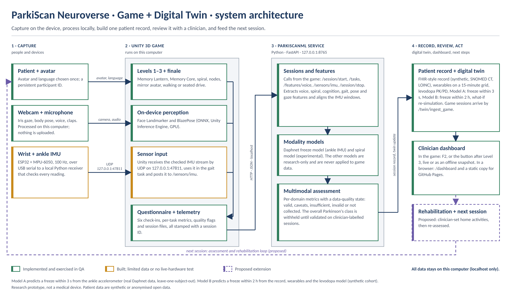
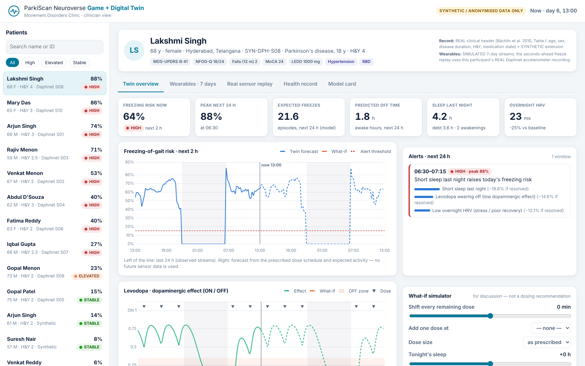
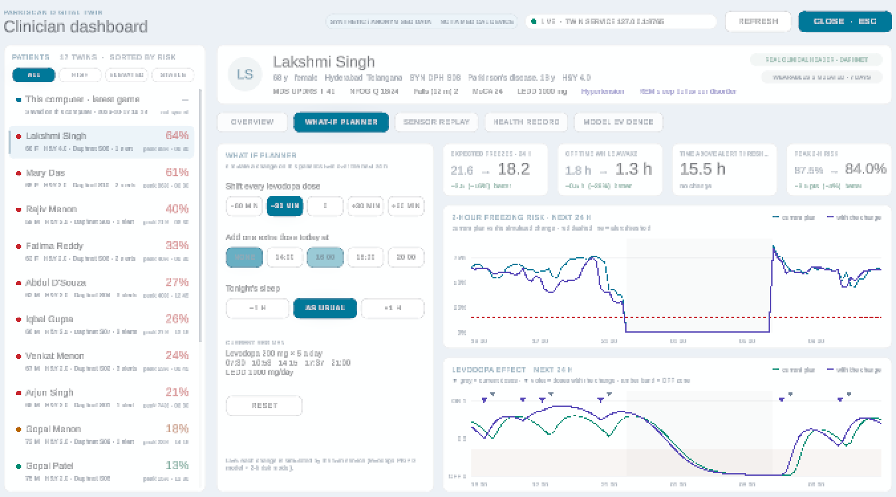

# ParkiScan Neuroverse — Game + Digital Twin

**ParkiScan Neuroverse is a home game that feeds a digital twin of a person with Parkinson's disease. The twin predicts freezing of gait — seconds ahead from a wearable, and hours ahead from the health record, wearables, a levodopa model and the game.**

Submission to the **Happiest Health · Reimagining and Reforming Healthcare in India Summit 2026 (Bengaluru) — Digital Twin Challenge, Phase 1.**

> Research prototype. Not a medical device. All patient data is synthetic or anonymised open data (DPDP Act sandbox rules). No output is a diagnosis or a treatment instruction.

## Submission at a glance

| | |
|---|---|
| **Demo video (15–20 min, unlisted YouTube)** | **[Watch the demo video on YouTube (unlisted)](https://youtu.be/iFfuZ8bI_iw)** |
| **Presentation (PDF)** | [docs/ParkiScan_Neuroverse_Game_DigitalTwin_Presentation.pdf](docs/ParkiScan_Neuroverse_Game_DigitalTwin_Presentation.pdf) |
| Presentation (PowerPoint) | [docs/ParkiScan_Neuroverse_Game_DigitalTwin_Presentation.pptx](docs/ParkiScan_Neuroverse_Game_DigitalTwin_Presentation.pptx) |
| **Architecture diagram (PDF)** | [docs/ParkiScan_Neuroverse_Game_DigitalTwin_Architecture.pdf](docs/ParkiScan_Neuroverse_Game_DigitalTwin_Architecture.pdf) · the architecture is also slide 6 of the presentation |
| Clinician dashboard demo (no install) | [docs/dashboard/](docs/dashboard/) · live at `https://kajjolsgs-bot.github.io/ParkiScan-Neuroverse/dashboard/` once GitHub Pages is enabled |
| AI/ML models, code and reports | [ParkiScanML/](ParkiScanML/) · [model reports](ParkiScanML/reports/) |
| Game (Unity 6.3 LTS) | settings in [Packages/](Packages/) and [ProjectSettings/](ProjectSettings/), setup notes in [docs/GAME_README.md](docs/GAME_README.md); the full `Assets/` folder is not in this repository because of its size, and the game is shown in the demo video |
| Licence | [LICENSE](LICENSE) (Apache-2.0) · [THIRD_PARTY_NOTICES.md](THIRD_PARTY_NOTICES.md) |
| Team | **CodeZero** — Kajjol Aiyer, Arya Kelychankandy · VIT Chennai |

### Demo video

[](https://youtu.be/iFfuZ8bI_iw)

[Watch on YouTube](https://youtu.be/iFfuZ8bI_iw) · unlisted, no sign-in needed · script: [`docs/VIDEO_SCRIPT.md`](docs/VIDEO_SCRIPT.md)

### Architecture at a glance



*Left to right: people and devices feed the Unity game; the game sends session data to the local service on `127.0.0.1:8765`; the service builds the patient record and digital twin; the clinician reviews it on the dashboard; the next session follows. PDF version: [`docs/ParkiScan_Neuroverse_Game_DigitalTwin_Architecture.pdf`](docs/ParkiScan_Neuroverse_Game_DigitalTwin_Architecture.pdf).*

### Where each required item is in this README

| Required item | Where |
|---|---|
| Team details · College / incubator | section 1 (Team) |
| Project title | the title at the top of this page |
| Problem statement | section 2 |
| Healthcare use case | section 2a |
| Technical stack | section 6 |
| AI/ML model or framework details | sections 5 and 3 |
| 15–20 minute demo video (unlisted YouTube) | the table above and section 8 |
| Open-source licence details | section 9 and `LICENSE` |
| Architecture diagram (PDF) | the table above and section 8 |
| Presentation (PDF / PPT) | the table above and section 8 |
| Public access | the repository is public and every link above is a file in it or a public link, with no sign-in needed |

---

## 1 · Team

| | |
|---|---|
| Team name | **CodeZero** |
| Team leader | Kajjol Aiyer — Integrated M.Tech, Computer Science with Business Analytics, VIT Chennai |
| Members | Kajjol Aiyer (team leader) · Arya Kelychankandy — both Integrated M.Tech, Computer Science with Business Analytics, VIT Chennai |
| College / incubator | VIT Chennai |
| Contact | Kajjol Aiyer — kajjol.sgs@gmail.com · Arya Kelychankandy — aryarajeev2204@gmail.com |

## 2 · Problem Statement

**Condition: Parkinson's disease (PD). Localised adverse event: freezing of gait (FoG).**

* India has roughly **5.8 lakh people living with PD — about 10% of the global burden** (Khurana & Gourie-Devi, *Cureus* 2025, citing GBD 2016), and the number grows with an ageing population.
* **Freezing of gait** — a sudden, brief inability to step — affects about **half of people with PD in earlier stages and up to ~80% as it progresses**, happens mostly in the levodopa OFF state and on turns, doorways and dual tasks, and **frequently leads to falls** (Conde et al., *Front. Neurol.* 2023).
* Care is reactive: a neurologist sees the patient every few months and relies on recall. Freezing, wearing-off and falls happen at home in between.

## 2a · Healthcare Use Case

**Use case.** A person with PD plays a short home game (ParkiScan Neuroverse) on a laptop and optionally wears a low-cost ankle sensor. Their **digital twin** — a per-patient virtual replica that combines the health record, wearable streams, a mechanistic levodopa model and the game's measurements — forecasts freezing risk for the next hours, warns seconds before a freeze, and lets the clinician test "what if" changes (dose timing, an extra dose, sleep) on the twin before discussing them with the patient.

## 3 · What makes it a digital twin

| twin property | how ParkiScan implements it |
|---|---|
| **A replica of one patient** | a FHIR R4-shaped record (conditions, scales, labs, genotype flags, levodopa schedule) + that person's own pharmacodynamic parameters (EC50, long-duration response) |
| **Continuously updated** | 15-minute wearable grid (steps, heart rate, sleep stages, overnight HRV, ankle-IMU gait instability) + game sessions synced at the end of every play-through |
| **Simulates physiology** | levodopa PK/PD: one-compartment oral absorption (t½ 1.5 h, Tmax ≈ 1 h), effect-site lag, individual EC50 and long-duration response → dopaminergic effect and ON/OFF state |
| **Predicts an adverse event** | **Model A**: FoG onset within 3 s from the ankle accelerometer (real data). **Model B**: FoG episode within the next 2 h from all streams (synthetic cohort) |
| **What-if** | the clinician changes dose timing, adds a dose, changes dose size or tonight's sleep; the twin is re-simulated with identical noise, so only the change differs |
| **Clinician view** | **inside the game** (F2, or CLINICIAN DASHBOARD on the title screen, the Three Lands, the pause MENU and the Level 3 twin report) and in a browser (`/dashboard`): risk timeline, alerts with drivers, ON/OFF curve, wearables, what-if, real-sensor replay, game measures, health record, model evidence |



*Clinician dashboard (`/dashboard`). More views: [what-if](docs/src/img/slide_whatif.png) · [real-sensor replay](docs/src/img/slide_replay.png) · [model card](docs/src/img/dash_model.png) · [game biomarkers](docs/src/img/dash_game.png).*

**The same dashboard inside the game.** Press **F2** anywhere (or CLINICIAN DASHBOARD on the title screen, the Three Lands or the pause MENU). At the end of Level 3, OPEN CLINICIAN DASHBOARD opens it on the player's own twin. It is drawn natively in Unity (no browser, no web-view plugin), pauses the game behind it and resumes it when closed (Esc). Tabs: overview, what-if planner, sensor replay (Daphnet twins), game sessions, health record, model evidence.

* **LIVE** when the twin service runs on this computer: every model runs, the what-if accepts any change, and sessions synced at the end of Level 3 appear as twins.
* **OFFLINE SNAPSHOT** when it does not: a pre-computed copy of the same API responses ships with the game (`Assets/StreamingAssets/TwinSnapshot`, 16 twins, 75 what-if scenarios each). The player's latest session saved on this computer is still listed, with SYNC NOW once the service is running.



## 3a · Designed for people with Parkinson's

How a person with PD is expected to respond to each part of the game, and what the design does about it:

| what PD changes | how the game responds |
|---|---|
| **Bradykinesia, slower reaction and movement start** | tasks never "fail" the player; slow, generous pacing; reaction and movement-start times are *measured* and recorded, not penalised |
| **Tremor and reduced fine-motor control** | large targets and buttons; spiral and node tasks record tolerance and smoothness, not pass/fail; keyboard / pointer fallbacks for the camera tasks |
| **Freezing, falls risk, fatigue** | a **seated mode** for Level 3 (steering instead of walking); walking is marching on the spot; every task can be **skipped cleanly** — nothing is carried to the next screen and no fake result is stored |
| **Response to external rhythm** | rhythmic auditory cueing improves gait speed, stride length and cadence in PD (meta-analysis, Ghai et al., *Sci Rep* 2018) — the clap-rhythm task measures rhythm keeping, and the twin's seconds-ahead warning is designed to trigger such a cue on a wearable |
| **Softer voice (hypophonia), reduced pitch variation** | voice tasks measure sustained-vowel duration and pitch variability, processed on the computer |
| **Mood, anxiety, cognitive load (dual tasks worsen freezing)** | NIA speaks short sentences in English, Hindi, Tamil, Telugu and Malayalam; one instruction at a time; encouraging "good code" banners; patient check-ins are stored as given and never scored |
| **ON/OFF fluctuations** | each session is time-stamped, so the twin can line game measures up with the levodopa ON/OFF curve |
| **Vision and contrast sensitivity** | clinical light theme: white panels, navy text, high contrast, large type; text over 3-D scenes gets a backing plate or halo |

Exergames are feasible and safe for people with PD and can improve balance and motor outcomes (systematic review, Garcia-Agundez et al., *J NeuroEng Rehabil* 2019). The game is a measurement tool first; we make no therapeutic claim.

## 4 · Data — fusion of two streams (sandbox rules)

| stream | source | real or synthetic |
|---|---|---|
| **Static / historical (EHR)** | Synthea-style generator in `ParkiScanML/parkiscan/twin/ehr.py` → FHIR R4 Bundle (Patient, Condition with SNOMED CT codes, Observation with LOINC codes, MedicationRequest). Every resource is tagged `SYNTHETIC`. | synthetic |
| | For the ten Daphnet participants, the record is anchored on the **real published clinical header** (age, sex, disease duration, Hoehn & Yahr, medication state — Bächlin et al. 2010, Table I) and extended synthetically. | real header + synthetic extension |
| **Dynamic (wearables / IoT)** | **Daphnet Freezing of Gait** — 3-axis accelerometers at ankle, thigh and trunk, 64 Hz, 10 people with PD, video-rated freezes (UCI ML Repository) | **real, anonymised** |
| | Consumer-wearable streams (steps, heart rate, sleep stages, HRV) — simulator in `parkiscan/twin/sim.py`, Apple Health / Google Fit style | synthetic |
| | ESP32 + MPU-6050 firmware and bridge for a live ankle/wrist sensor (`ParkiScanML/firmware`, `parkiscan/sensors`) | live hardware path (optional) |
| **Game measurements** | ParkiScan Neuroverse tasks: webcam gaze, voice, rhythm, memory, spiral drawing, sequencing, reaction time, mirrored movements, stepping, steering | observed in play (QA runs flagged) |

Other open datasets used by the existing ParkiScanML models (PhysioNet gait, UCI spiral drawings, Oxford voice, telemonitoring) are documented in `ParkiScanML/reports/training_report.md`.

## 5 · AI/ML Model and Framework Details

### Model A — freezing onset within seconds (real data, leave-one-subject-out)

Target: a freeze **starts** within H seconds of "now" (windows that already contain freezing are excluded — that is detection, not prediction). 4-s causal windows, 0.5-s hop; spectral band powers, Moore–Bächlin freeze index, cadence, step regularity, jerk and their 2–6 s trends. Histogram gradient boosting. The test person is never seen in training; the alarm threshold of each fold is chosen on the training subjects only. The deployed configuration (**ankle IMU + real clinical header**) was fixed **before** seeing results, to match the game's single ankle sensor.

ROC AUC, pooled out-of-fold over 10 held-out people, 95% CI by subject bootstrap (35,405 windows).

| freeze onset within | freeze-index baseline | ankle IMU | ankle IMU + clinical header | 3 IMUs | 3 IMUs + header |
|---|---|---|---|---|---|
| 2 s | 0.63 | 0.76 (0.71–0.83) | 0.74 (0.62–0.85) | – | – |
| 3 s | 0.60 | 0.76 (0.72–0.83) | 0.75 (0.65–0.85) | 0.79 (0.75–0.85) | 0.76 (0.68–0.84) |
| 5 s | 0.56 | 0.73 (0.70–0.79) | 0.70 (0.59–0.80) | – | – |

**Event level (deployed, H = 3 s):** **148 of 237 freezes (62%) were preceded by an alarm in the 5 s before onset**, median lead time **4.6 s**. Window level: sensitivity 0.52, specificity 0.84. As a wearable cue (10-s refractory period) this setting produces 96 false cues per hour of walking, in a lab protocol that provoked ≈ 53 freezes per hour. The clinician can trade sensitivity for fewer cues:

| setting (window specificity) | freezes warned | false cues / h | median lead |
|---|---|---|---|
| 0.85 | 61% (144/237) | 94 | 4.6 s |
| 0.90 | 54% (128/237) | 73 | 4.3 s |
| 0.95 | 43% (103/237) | 40 | 3.8 s |
| 0.97 | 35% (83/237) | 26 | 3.2 s |
| 0.99 | 19% (44/237) | 9 | 2.7 s |

Full per-participant table: `ParkiScanML/reports/fog_forecast_report.md`.

Context: the closest published benchmark we found — Palmerini et al., *Front. Neurol.* 2017, 2-s pre-freeze windows, leave-one-subject-out on the CuPiD dataset — reported a mean AUC of 0.76. Fusing the clinical header did not improve Model A (10 distinct patients are too few to learn from patient-level variables); this is reported, not hidden.

### Model B — freezing episode within 2 hours (digital-twin fusion, synthetic cohort)

Synthetic cohort: 400 patients × 7 days, 30-min samples while awake, day 0 burn-in. Target: ≥1 freezing episode in the next 2 h (simulated ground truth). Validation: patient-grouped 5-fold CV. Prevalence 6.7%.

| inputs | ROC AUC | PR AUC | Brier |
|---|---|---|---|
| ehr_only | 0.779 | 0.255 | 0.0556 |
| wearable_only | 0.759 | 0.256 | 0.0557 |
| ehr+wearable | 0.799 | 0.277 | 0.0550 |
| digital_twin (ehr+wearable+pk) | 0.806 | 0.281 | 0.0547 |

Alerting on the top 10% of risk captures **45%** of the 2-hour windows that contain a freeze (precision 30%, lift **4.5×**). Calibration by risk decile is in `twin_risk_report.json`.

Labels come from the documented hazard simulator (`parkiscan/twin/sim.py`: freezing more likely when OFF, while walking, with higher freezing trait, short sleep and low HRV). The ablation shows the fusion pipeline recovers more of the simulated risk than any single stream; **it is not evidence of clinical accuracy.**

### Mechanistic core — levodopa PK/PD

Elimination half-life 1.5 h and Tmax ≈ 1 h for immediate-release levodopa/carbidopa follow Hayashi et al., *Front. Pharmacol.* 2025 (measured t½ 1.48–1.64 h; Tmax 0.5–2 h). Unit tests check both (`tests/test_twin.py`).

### On-device perception in the game (Unity Inference Engine, GPU)

| task | model | what changed in this version |
|---|---|---|
| L1 lantern (eye tracking) | BlazeFace short-range → **MediaPipe Face Landmarker v2 (478 points incl. irises)** | new: works close to a laptop camera; iris-in-eye + head-pose features; 9-dot calibration with leave-one-point-group-out error; live eye overlay. ONNX conversion verified against the original TFLite (max landmark difference 0.0004 px) and against a Python reference in Unity |
| L3 mirror avatar | BlazePose full (33 points) | new: ROI tracking from the model's alignment points (detector re-runs only when the pose is lost), an arm resting below the frame counts as down, a raised arm above the frame keeps its last angle, live per-arm guidance, 1-s hold |
| L3 walking path | BlazePose | new: fused knee-lift signal (thigh angle + knee and ankle rise) and an upper-body sway fallback when the knees are out of view |
| L3 vehicle | BlazePose | new: steering task — hold an imaginary wheel to drive, tilt to steer, hands down to brake; lane keeping on a curving road with cross-wind, memory orbs, red lights; lane offset, time in lane, steering steadiness, brake / go latency |

## 6 · Technical Stack

* **Game:** Unity 6.3 LTS (URP), C#, Unity Inference Engine 2.6 (ONNX), Input System, TextMeshPro; English + 4 Indian languages (Hindi, Tamil, Telugu, Malayalam).
* **Twin service:** Python 3.10–3.13, FastAPI, pydantic, NumPy, pandas, SciPy, scikit-learn (HistGradientBoosting), librosa, pytest.
* **Dashboard:** in the game, native Unity UI (uGUI + TextMeshPro, a custom chart mesh `UIPlot`) reading the twin API or the bundled snapshot; in the browser, vanilla JavaScript + Chart.js 4.4.1 (bundled, works offline), served at `/dashboard`.
* **Hardware (optional):** ESP32 + MPU-6050 IMU, 100 Hz, serial / UDP.
* **Standards:** FHIR R4 resource shapes, SNOMED CT and LOINC codes for conditions and labs.

## 7 · Run it

```bash
# 1 · twin service + dashboard
cd ParkiScanML
python3 -m venv .venv && source .venv/bin/activate
pip install -r requirements.txt
./run_local.sh                               # http://127.0.0.1:8765/dashboard   (API docs: /docs)

# 2 · reproduce the models (optional; trained models are included)
python tools/prepare_datasets.py --zips ~/Downloads     # Daphnet zip → data/raw/daphnet
python -m training.fog_forecast_train        # Model A  (≈ 20–40 min on a laptop)
python -m training.twin_risk_train           # Model B  (≈ 5–20 min)
pytest                                       # unit + API tests

# 3 · the game
# open the Unity project (Unity 6.3 LTS), scene Assets/ParkiScan/Scenes/Demo.unity, press Play.
# At the end of Level 3 the twin report syncs the session to the twin (patient "You — game session").
# Clinician dashboard inside the game: F2 at any time (LIVE with the service running, OFFLINE SNAPSHOT without it).
# Refresh the offline snapshot after retraining: python ParkiScanML/tools/export_static_dashboard.py --unity
```

## 7a · Repository layout

```
Assets/ParkiScan/            Unity game (scene Scenes/Demo.unity)
  Scripts/Demo/              DemoDirector_* — game flow: levels 1–3, steering drive, twin report, India finale
  Scripts/Tracking/          PoseTracker (BlazePose + ROI tracking), FaceTracker (BlazeFace + 478-point face mesh), pose features
  Scripts/UI/                clinical light design tokens (UIStyle), components, readability guard
  Scripts/Twin/              in-game clinician dashboard (ClinicianDashboard*), twin data client (live / snapshot), chart mesh (UIPlot)
  Scripts/Telemetry/         local task records (JSON/CSV) + client of the twin service
  Scripts/Editor/            scene builder and automated QA play-throughs (menu ParkiScan → QA)
  Resources/FaceMesh/        on-device face and iris models (ONNX)
Assets/StreamingAssets/TwinSnapshot/   offline copy of the twin API for the in-game dashboard (export_static_dashboard.py --unity)
ParkiScanML/                 Python service
  parkiscan/twin/            digital twin: synthetic EHR (FHIR), Daphnet header, PK/PD, simulator, risk model, engine
  training/                  fog_forecast_train.py (Model A), fog_forecast_events.py, twin_risk_train.py (Model B)
  app/                       FastAPI app, twin API (twin_api.py), clinician dashboard (dashboard/)
  models/, reports/          trained models and evaluation reports
  tests/                     pytest suite (59 tests: features, API, sensors, twin, secret hygiene)
docs/                        architecture PDF, presentation PDF, video script, game README, assessment mapping
```

`Assets/` (the Unity project content) is listed above for reference only. It is not in this repository because of its size; the game is shown in the demo video, and its settings are in `Packages/` and `ProjectSettings/`.

Unity setup details (version, packages, webcam, voices): [`docs/GAME_README.md`](docs/GAME_README.md).

## 8 · Deliverables

| item | where |
|---|---|
| **Dashboard demo, no install** | `docs/dashboard/` — open at `https://kajjolsgs-bot.github.io/ParkiScan-Neuroverse/dashboard/` once GitHub Pages is enabled (Settings → Pages → branch `main`, folder `/docs`). Pre-computed copy: 17 twins, real-sensor replay, 75 what-if scenarios per twin; regenerate with `python ParkiScanML/tools/export_static_dashboard.py` |
| **In-game clinician dashboard** | in the game: **F2**, or CLINICIAN DASHBOARD (title screen, Three Lands, pause MENU, Level 3 twin report) — works with or without the twin service |
| **Demo video (15–20 min, unlisted YouTube)** | [https://youtu.be/iFfuZ8bI_iw](https://youtu.be/iFfuZ8bI_iw) — script: `docs/VIDEO_SCRIPT.md` |
| Architecture diagram (PDF) | `docs/ParkiScan_Neuroverse_Game_DigitalTwin_Architecture.pdf` |
| Presentation (PDF / PPT) | [`docs/ParkiScan_Neuroverse_Game_DigitalTwin_Presentation.pdf`](docs/ParkiScan_Neuroverse_Game_DigitalTwin_Presentation.pdf) and [`.pptx`](docs/ParkiScan_Neuroverse_Game_DigitalTwin_Presentation.pptx) |
| Model reports | `ParkiScanML/reports/fog_forecast_report.md`, `twin_risk_report.md`, `training_report.md` |
| Licence | `LICENSE` (Apache-2.0) and `THIRD_PARTY_NOTICES.md` |

## 9 · Open-source licence

Source code: **Apache License 2.0** (`LICENSE`). Third-party models, libraries and datasets keep their own licences — see `THIRD_PARTY_NOTICES.md` (MediaPipe models Apache-2.0; Chart.js MIT; Daphnet dataset CC BY 4.0 with the required citation).

## 10 · Limits we state openly

* Model A was trained on 10 people in a laboratory protocol built to provoke freezing (≈ 53 freezes per hour of walking); its false-cue rate is high at the sensitive setting and will differ at home. Two participants never froze, and two (S03, S07) were rarely warned.
* Model B and all consumer-wearable streams are synthetic; Model B's accuracy is a property of the simulator.
* Webcam measurements are 2-D, single-camera estimates; the iris gaze is not an infrared eye tracker. Every record carries quality flags; simulated and QA runs are labelled.
* Patient-reported check-ins are stored as given and never scored.

## 11 · References

* Bächlin M, Plotnik M, Roggen D, et al. Wearable assistant for Parkinson's disease patients with the freezing of gait symptom. *IEEE Trans Inf Technol Biomed* 2010;14(2):436–446. (Daphnet dataset.)
* Palmerini L, Rocchi L, Mazilu S, Gazit E, Hausdorff JM, Chiari L. Identification of characteristic motor patterns preceding freezing of gait in Parkinson's disease using wearable sensors. *Front Neurol* 2017;8:394.
* Conde CI, Lang C, Baumann CR, Easthope CA, Taylor WR, Ravi DK. Triggers for freezing of gait in individuals with Parkinson's disease: a systematic review. *Front Neurol* 2023;14.
* Khurana S, Gourie-Devi M. A narrative review of community-based epidemiological studies on Parkinson's disease in India. *Cureus* 2025;17(3):e80248.
* Hayashi A, et al. A phase I study to evaluate the effect of high-dose carbidopa on levodopa pharmacokinetics. *Front Pharmacol* 2025;16:1596139.
* Ghai S, Ghai I, Schmitz G, Effenberg AO. Effect of rhythmic auditory cueing on parkinsonian gait: a systematic review and meta-analysis. *Sci Rep* 2018;8:506.
* Garcia-Agundez A, Folkerts AK, Konrad R, et al. Recent advances in rehabilitation for Parkinson's disease with exergames: a systematic review. *J NeuroEng Rehabil* 2019;16:17.
* Lugaresi C, et al. MediaPipe: a framework for building perception pipelines. 2019; MediaPipe BlazePose, BlazeFace and Face Landmarker model cards (Google, Apache-2.0).
